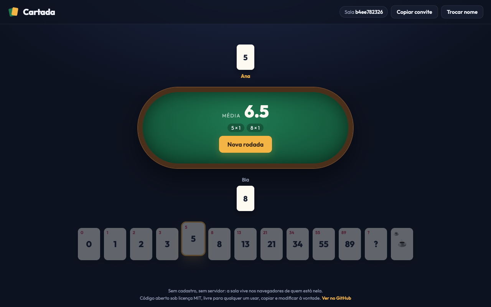

<div align="center">

# Cartada

**Planning poker direto ao ponto.** Abra uma mesa, mande o link e estimem juntos.

Sem cadastro · Sem servidor · Sem banco de dados · Grátis

**[cartada-planning-poker.vercel.app](https://cartada-planning-poker.vercel.app)**



</div>

## Como usar

1. Digite seu nome e clique em **Criar sala**.
2. Clique em **Copiar convite** e mande o link para o time.
3. Cada pessoa escolhe uma carta. Ninguém vê o voto dos outros, e quem ainda não votou fica piscando na mesa.
4. Alguém clica em **Revelar cartas**: contagem 3, 2, 1 e as cartas viram.
5. Aparecem a média, a distribuição dos votos e o selo de **Consenso!** quando todos votam igual. Quem mudar de ideia ainda pode trocar o voto: a média recalcula e a carta fica marcada como alterada.
6. Clique em **Nova rodada** e repita.

Quem conduz a sessão sem estimar (PO, facilitador) marca **Só assistir**: fica fora da mesa e da contagem de votos, mas pode revelar e iniciar rodadas.

Baralho: `0 1 2 3 5 8 13 21 34 55 89 ? ☕`

## Como funciona

O Cartada é **um único arquivo HTML**. Não tem backend nem banco de dados.

- **Peer-to-peer:** os navegadores conversam direto entre si via WebRTC ([PeerJS](https://peerjs.com)). O servidor público do PeerJS só faz a apresentação entre eles; os votos não passam por ele.
- **Anfitrião automático:** o primeiro navegador a abrir a sala guarda o estado da mesa. Se ele sair, outro participante assume em poucos segundos, sem perder os votos nem as cartas já reveladas.
- **Memória local:** seu nome, o modo espectador, sua identidade anônima e a última sala ficam no `localStorage` do navegador por 1 ano. Ao abrir outro link, você entra direto; na home, aparece um atalho para voltar à última sala, se ela ainda tiver gente.
- **Nada fica guardado:** quando todos saem, a sala deixa de existir.
- **Privacidade e integridade:** usa a fonte do sistema (nenhuma chamada ao Google Fonts), e o PeerJS vem do CDN travado por hash ([SRI](https://developer.mozilla.org/docs/Web/Security/Subresource_Integrity)): se o arquivo for adulterado, o navegador se recusa a executá-lo.

## Rodando localmente

Qualquer servidor estático serve:

```bash
git clone https://github.com/antoniovini47/cartada-planning-poker.git
cd cartada-planning-poker
python3 -m http.server 8000
```

Abra `http://localhost:8000`. Para publicar, basta subir o `index.html` em qualquer hospedagem estática (Vercel, Netlify, GitHub Pages...).

## Limitações

- A conexão é direta entre navegadores e não há servidor de retransmissão (TURN). Em redes corporativas muito restritas, ela pode falhar.
- Não há controle de permissão: qualquer pessoa da sala pode revelar ou começar uma nova rodada. É pensado para times que confiam uns nos outros.

## Contribuindo

Issues e pull requests são bem-vindos. O código é vanilla JS, sem build e sem dependências além do PeerJS via CDN.

## Licença

[MIT](LICENSE). Use, copie, modifique e distribua à vontade.
